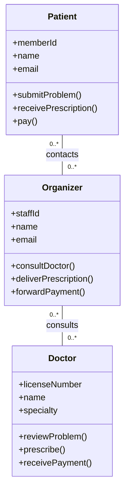
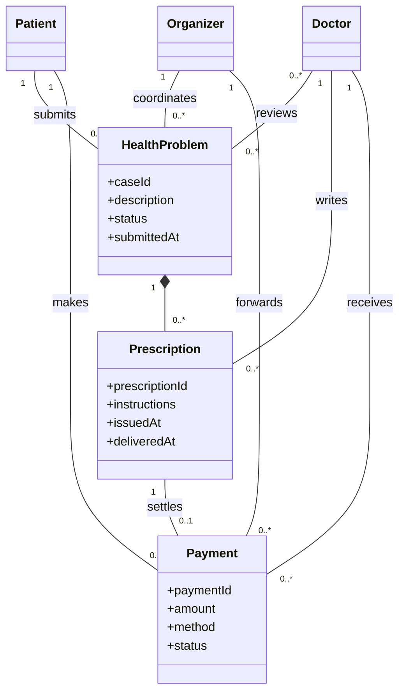
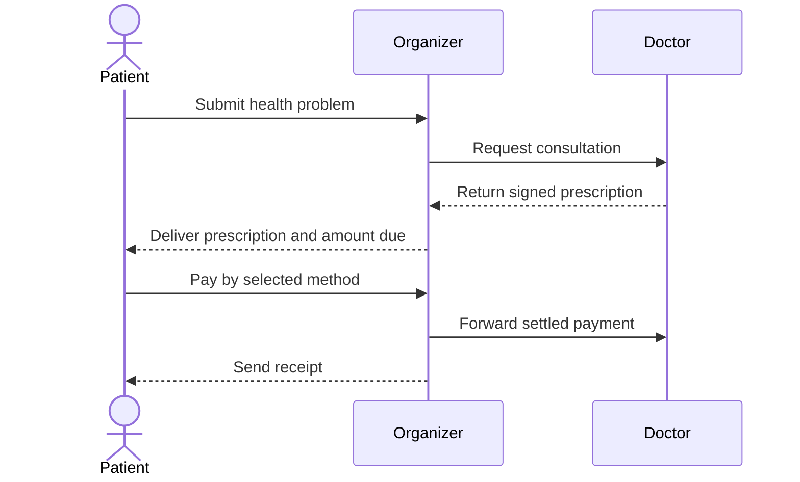
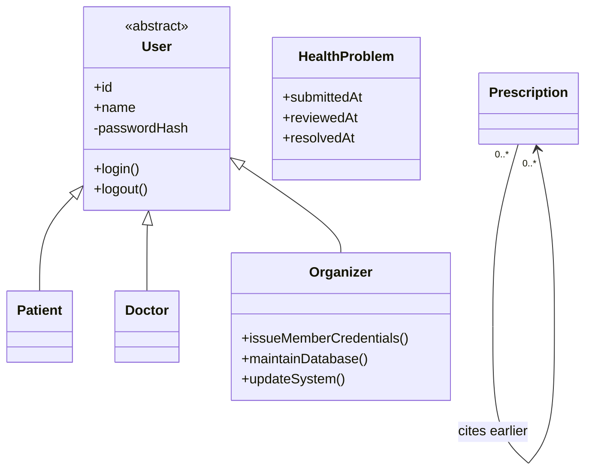
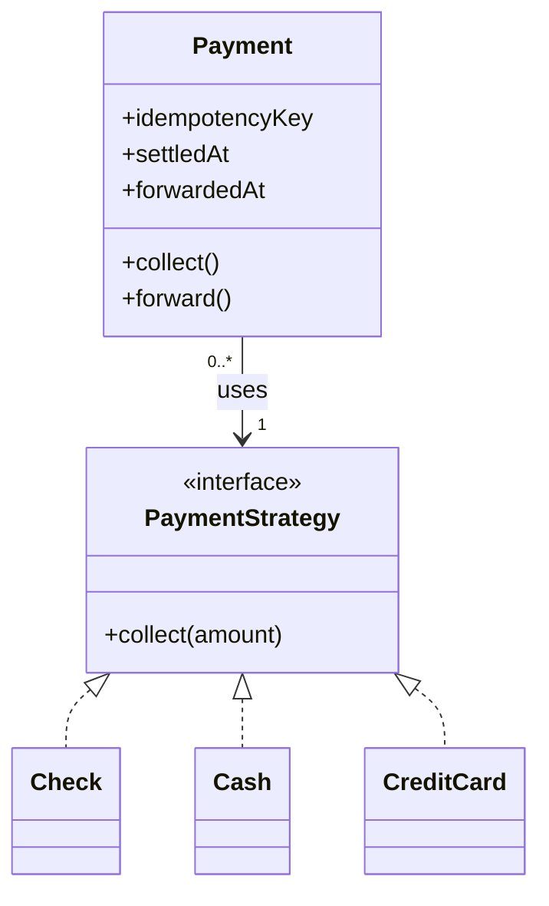
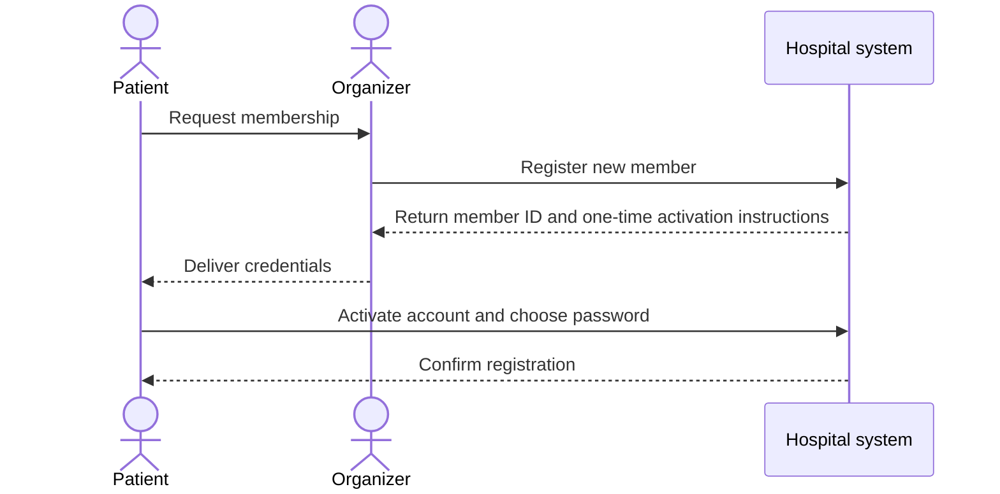
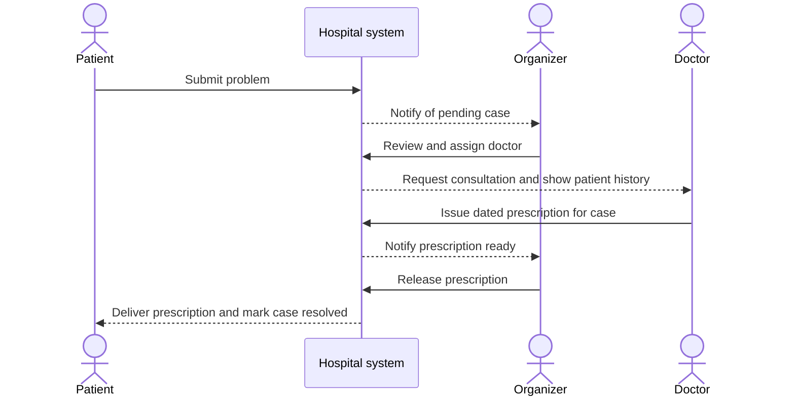
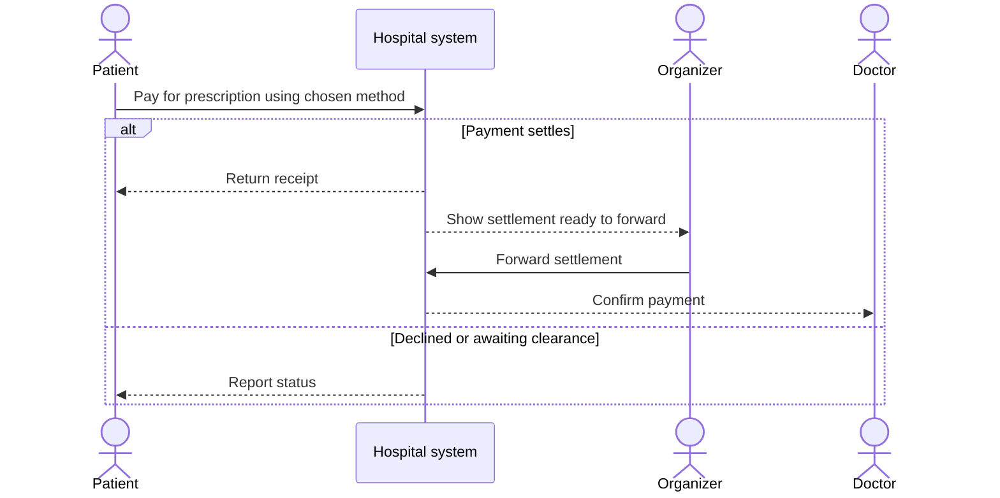

# Hospital management

## 1. Staff and patient roles

Each case has one coordinator. A patient and a doctor can each work with several coordinators across different cases.

## 2. Cases, prescriptions, and payments

A payment method is Check, Cash, or CreditCard. The advanced model below supplies its behavior.

## 3. Shared identity, case history, and payment strategy

The diagrams below extend the case model. A case starts pending, moves to in-review at consultation, and becomes resolved when the organizer delivers the prescription. The case keeps its submission, review, and resolution times. A doctor can reference earlier prescriptions for the same patient while issuing a new dated record.

**Registration**

**Consultation**

**Payment**

Multiple doctors can review a case. Each prescription identifies the doctor who signed it, which also identifies the payee. Prior prescriptions are reusable as references, with amendments recorded as new prescriptions. Payment uses the Strategy pattern. Check payments wait for clearance. A unique request key prevents duplicate collection, and one forwarding record per settled payment prevents a second payout. The system records each change of status and its timestamp in the same transaction as its ledger entry.
