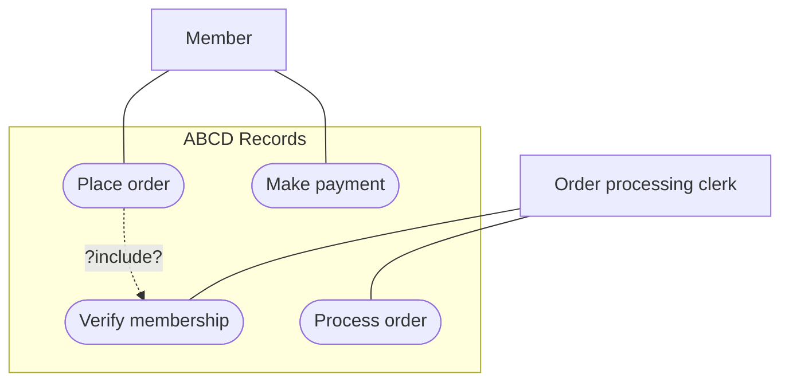
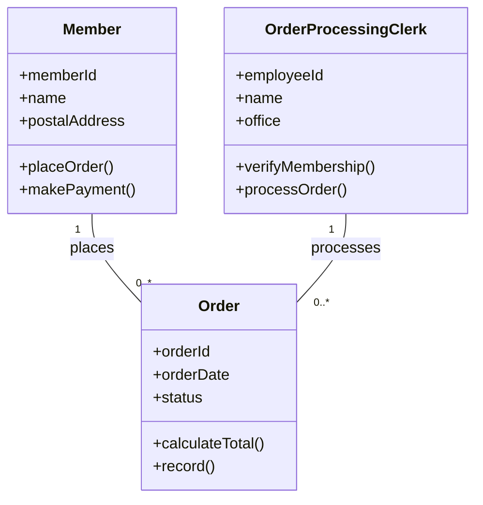
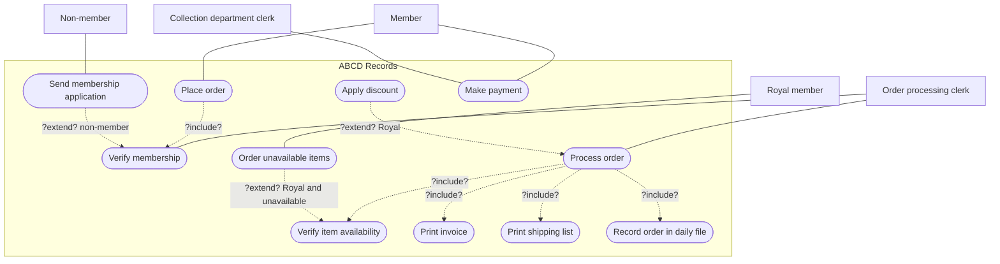
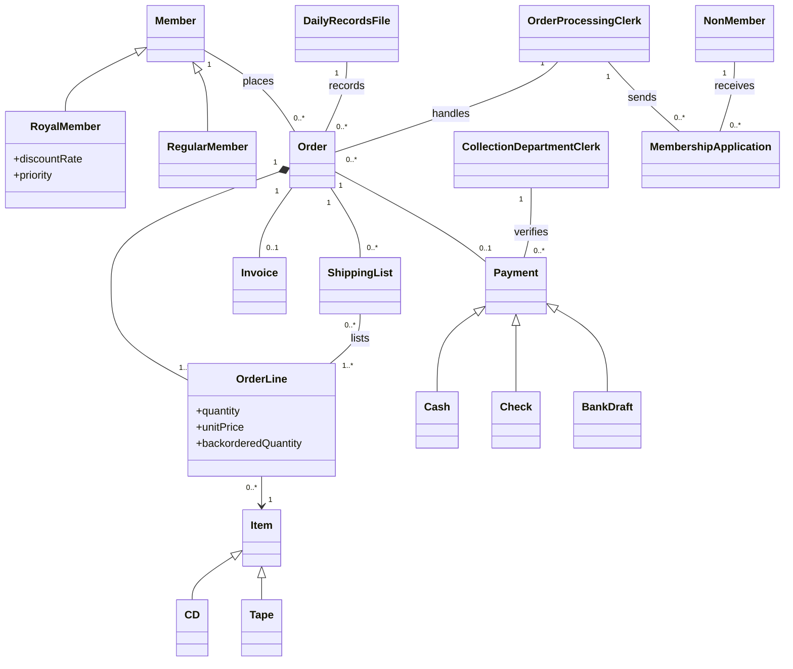
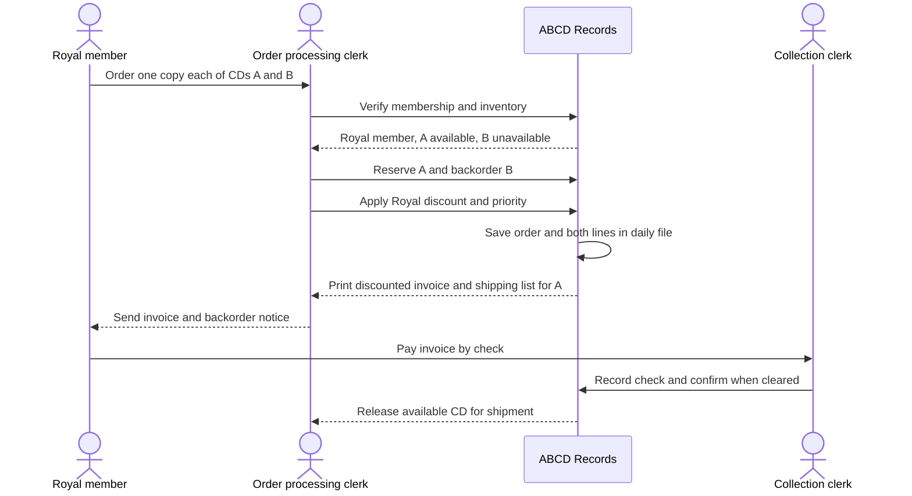
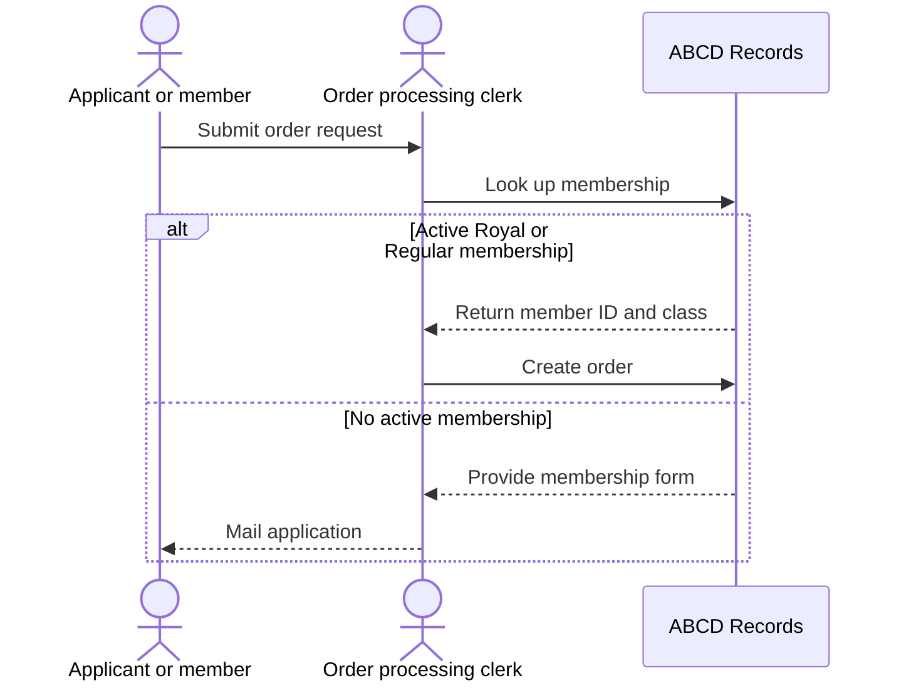
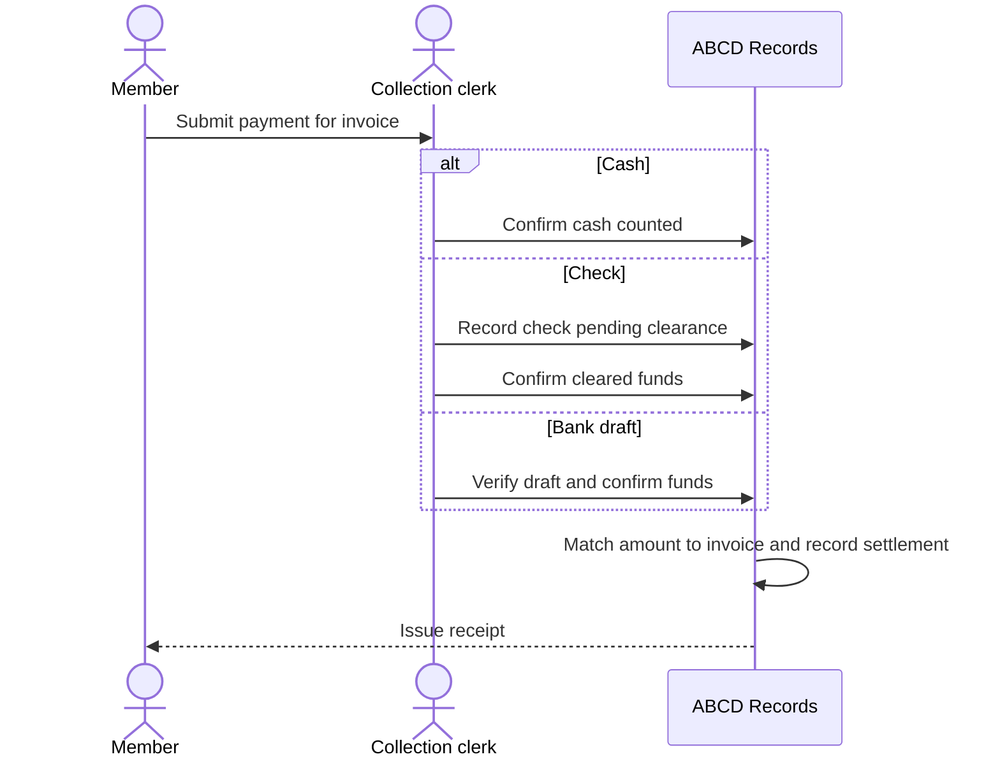
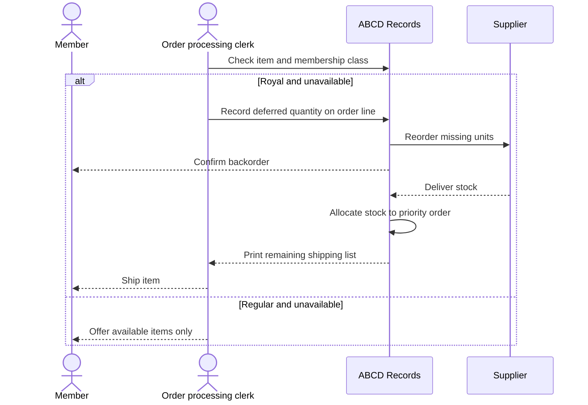

# ABCD Records

## 1. Basic use cases and classes

Rounded nodes denote use cases. Rectangular nodes outside the boundary denote actors.

## 2. Membership, fulfillment, and settlement

Royal members receive a discount and priority processing. They may put unavailable items on backorder. A failed membership check produces an application before any order is accepted.

## 3. Sequence diagrams

**Complete order.** A Royal member orders two different CDs, one copy of each, and pays by check. The deferred line stays on the same order for later shipment.

**Membership verification**

**Payment processing**

**Royal backorder fulfillment**

