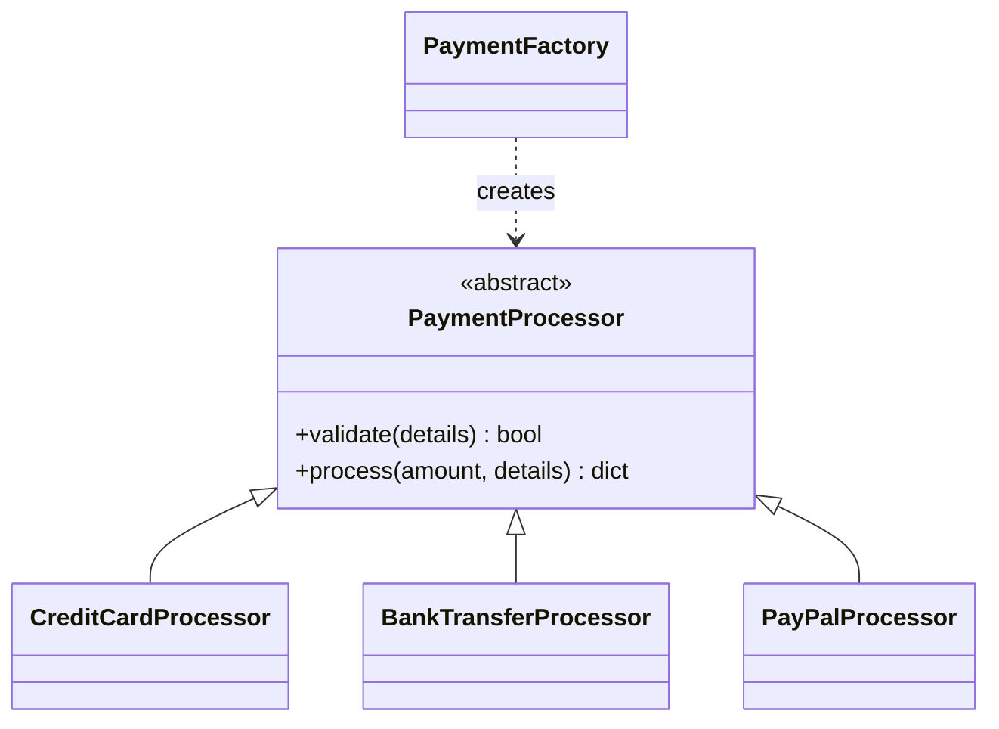
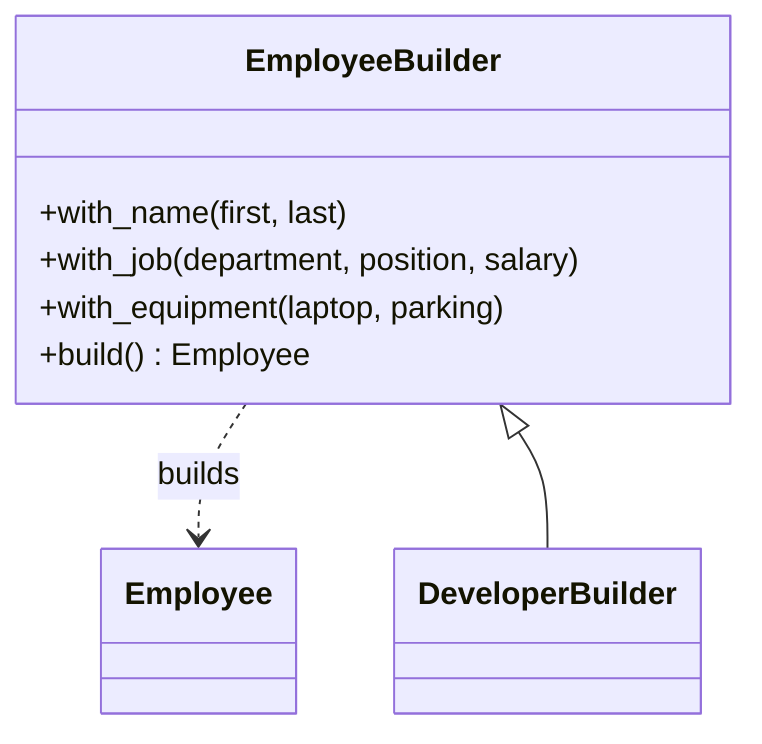
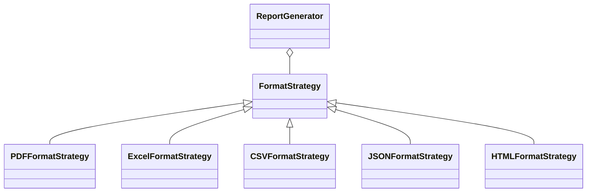
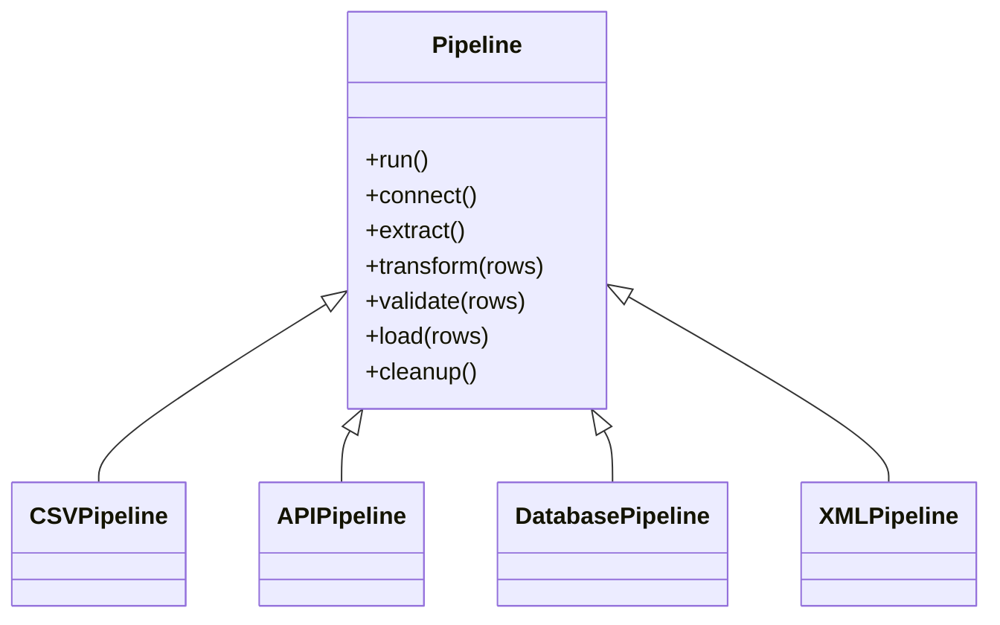

# Design patterns

## Factory �� payment processing

## Builder �� employee onboarding

## Strategy �� report formats

The original generator repeats the format selection in two methods. Adding a format requires editing both. Testing one renderer also requires setting up the whole generator. The refactor lets the caller switch strategies on the same generator. The PDF and Excel strategies produce the classroom text previews when printed and native documents when saved.

## Template Method �� ETL pipelines

Each original pipeline repeats the workflow order, validation loop, and cleanup. An exception during transformation skips cleanup. The base class now runs cleanup even when a step fails. As in the exercise, the three original sources use sample records and loading reports the row count. The XML extension reads an XML file.

## Running the examples

From this folder, run `python demo.py`. To save native PDF or Excel reports, install `python -m pip install -r requirements.txt` and call `save_report("sales_report")` with the corresponding strategy selected. The adapter reads the legacy generator's XML. The decorator example combines shipping, insurance, gift wrapping, and two discounts on the same order.
